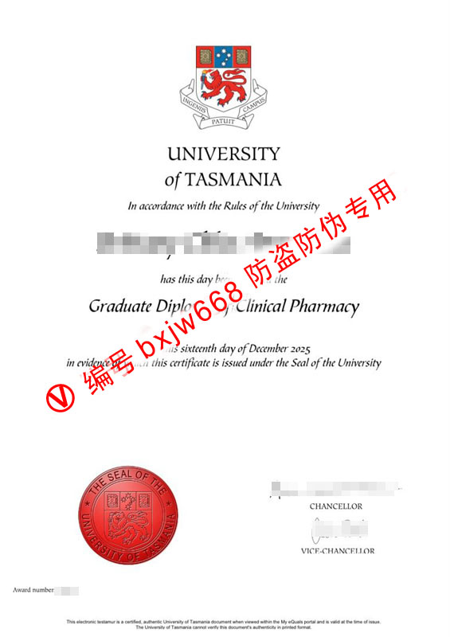

# 塔斯马尼亚大学毕业证样式范本（University of Tasmania） 核验真实

在涉外人才引进、跨国企事业单位入职资格审查以及中国教育部留学服务中心（留服认证）的严密审核流程中，如何高效地**核验真实**一份海外高等教育学历，始终是人力资源管理与学术背景调查的核心课题。作为澳大利亚历史第四悠久的“沙岩学府”（Sandstone Universities）之一，**塔斯马尼亚大学（University of Tasmania，简称 UTAS）** 颁发的官方学位证书（Testamur）不仅在全球享有极高的学术含金量，其本身的设计更是一部完美融合了百年古典英联邦美学与现代高科技防伪工艺的视觉范本。

塔斯马尼亚大学在生命科学、医学及药学领域的研究实力高居世界前列。对其极具代表性的医疗王牌专业——**临床药学研究生文凭（Graduate Diploma of Clinical Pharmacy）** 的最新真实证书样本进行微观解析，能够帮助各验证机构建立精准的视觉参照。本文将为您深度拆解 UTAS 毕业证的排版特征、物理防伪矩阵以及官方数字化核验渠道。

---

## 2026款UTAS官方证书整体视觉布局：百年沙岩学府的古典美学与庄重格调

与许多追求极端现代简约风的新兴大学不同，塔斯马尼亚大学的官方学位证书依然坚守着英联邦古老学府的优雅传统。该证书采用标准的 **纵向（Portrait）A4 格式（210×297mm）**，整体基调呈现出沉稳、厚重且温润的象牙白色特种纸质感，在光线下不反光，带有一种厚重的历史宣纸感。

在证书的顶部正中央，最醒目的莫过于 UTAS 经典的**彩色官方盾徽（University Crest）**。该盾徽设计极其考究，顶部为一顶金色的王冠，下方盾牌内部包含代表着南十字星的蓝色星空，以及一只高举火炬、代表力量与智慧的红色雄狮（Lion Rampant）。校徽下方的白色缎带上，分两行镌刻着拉丁文校训：*“INGENIIS PATUIT CAMPUS”*（思想的校园，向所有人开放）。整个校徽采用极为精细的高精度多色套印工艺，作为证书的视觉巅峰锚点，散发着浓厚的学术神圣感。

---

## 临床药学文凭核心文字排版与英文书法体（Script Font）层级艺术

文字排版是一张证书向世界传递其法律效力与学术尊严的核心载体。UTAS 文凭在字体的选择与视觉层级上展现出了极高的排版水准，完美融合了印刷体的端正与手写体的灵动：

1. **颁发机构最高宣告：** 在顶部盾徽下方，是加粗放大的学校官方全称：**“UNIVERSITY of TASMANIA”**。学校在此处采用了一种具备古典罗马风格的衬线字体，字间距经过微调加宽，展现出无可替代的权威地位。
2. **法理授权描述层级：** 紧随其后的是一行纤细的斜体字：*“In accordance with the Rules of the University”*（根据大学章程规定），起到了非常流畅的视觉过渡作用。
3. **学生姓名黄金区：** 毕业生的法定姓名横跨在证书的正中央黄金分割线位置。为了凸显毕业生的主体地位，姓名使用了字号显著放大的现代加粗衬线字体，留白极其宽裕，给人以极强的仪式感。
4. **学位头衔最终确权（核心视觉重心）：** 证书的绝对视觉核心是授予的学位——**“Graduate Diploma of Clinical Pharmacy”**（临床药学研究生文凭）。为了彰显这一医疗王牌专业的独特含金量，学校在此处精选了极为华丽、舒展的**英文书法斜体字（Italic Script Font）**。这种优美的书法连笔风格与上下两端的标准印刷体形成了极其强烈的视觉反差，不仅极具现代设计的艺术美感，也是物理纸张防伪比对的关键微观特征之一。
5. **精准签发时间声明：** 在学位头衔下方，继续用优雅的斜体字精准标明了文凭的授予日期，例如 **“on this sixteenth day of December 2025”**（于2025年12月16日）。紧接着是一行法律宣告：*“in evidence of which this certificate is issued under the Seal of the University”*（以此为证，本证书经大学印章授权签发）。

---

## 物理防伪最高级别：左下角官方火漆红印（The Seal）与双重官员签章

证书的底部是体现官方最高授信、同时也是安全防伪技术最密集的区域，其布局元素环环相扣：

| 布局要素 | 视觉特征描述 | 核心作用与防伪功能深度解析 |
| :--- | :--- | :--- |
| **左下角：官方齿边火漆红印 (The Seal)** | 位于证书左下角，为一个大面积的暗红色圆形齿边印章样式（The Seal of the University of Tasmania）。红印内圈清晰呈现了大学官方雄狮盾徽与内部格栅线条，边缘带有凹凸感强烈的物理咬合压痕。 | **核心物理防伪：** 采用专用的物理重压模具在特种防伪涂层上压制而成。印章凹凸感强烈，具有无法通过普通激光打印机或彩色复印机复制的立体防伪特性，是肉眼核验真实的第一道关卡。 |
| **右下角：双重官员联袂签章** | 位于证书右下角，包含 **CHANCELLOR**（校监）与 **VICE-CHANCELLOR**（校长）的上下并列官方手写体电子签名，下方配有精准的职务说明文本。 | **法律效力背书：** 代表大学管理阶层与学术行政阶层的最高联合授权，赋予文凭在国际法理上的全面认可度。 |
| **左下角最底部：Award number** | 位于火漆红印的左下方，印有唯一的内部档案序列编码（如 **Award number: XXXXXX**）。 | **数据防伪与索引：** 每一个编码在校内数据库中都具有唯一性，与该毕业生的学籍档案、成绩单完全一一绑定。 |

---

## 澳洲AQF国家框架认证与塔斯马尼亚大学官方数字链上核验渠道

在现代化的安全审查中，纯粹依靠肉眼观察物理毕业证的火漆红印、手写签名或印刷字体，已经不足以防范高科技造假。作为澳大利亚高等教育体系的重要成员，塔斯马尼亚大学的所有学位完全被纳入了 **AQF（Australian Qualifications Framework，澳大利亚学历资格框架）** 的严格监管之下。

为了彻底维护学术尊严并保护毕业生的合法权益，塔斯马尼亚大学官方学历验证系统为全球雇主和认证机构提供了多维度的自动化数字化核验渠道：

### 核心验证途径：My eQuals 官方数字证书平台
在证书的最底部，印有一行极其精细的微缩安全文本：*“This electronic testamur is a certified, authentic University of Tasmania document when viewed within the My eQuals portal... The University of Tasmania cannot verify this document's authenticity in printed format.”*（本电子证书在 My eQuals 平台内查看时，即为经认证的真实的塔斯马尼亚大学文件……大学无法验证打印格式的真实性）。

这一行字揭示了当前澳洲最高级别的数字防伪标准。UTAS 早已全面接入了澳大利亚与新西兰高校联合推出的 **My eQuals** 官方区块链数字证书存证系统。合法的 UTAS 毕业生在毕业时会获得一份带有官方加密电子签名的数字文凭。企业 HR 或是学术背调机构只需要求学生提供其在 My eQuals 平台上的专属分享链接。

该系统基于先进的加密技术，链上数据直接由塔斯马尼亚大学教务处数据库实时渲染生成。通过该系统，验证机构能够瞬间 **100% 确认** 证书上的毕业生姓名、学号、学位名称（如 *Graduate Diploma of Clinical Pharmacy*）及颁发时间（如 *16 December 2025*）的绝对真实性。

综上所述，塔斯马尼亚大学的毕业证范本不仅在排版视觉上完美传承了英联邦百年名校的尊贵与优雅，更在防伪设计上引入了“物理火漆红印”与“My eQuals 区块链链上存证”的双重防伪矩阵，以无可辩驳的技术实力，完美护航每一位 UTAS 毕业生的学术成果与核验真实的含金量。

